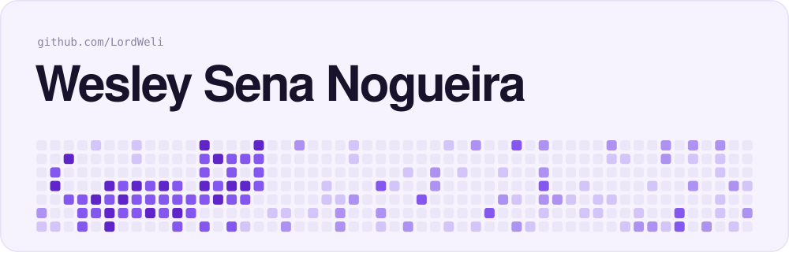
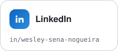
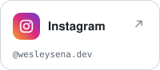
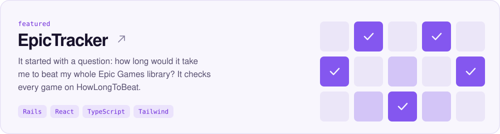
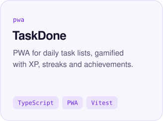
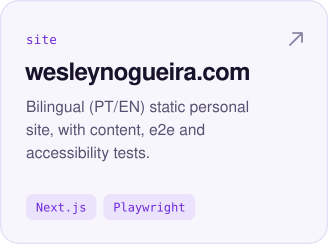
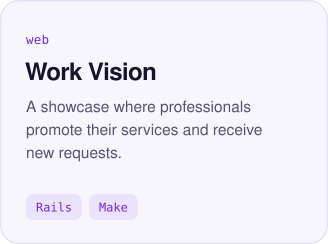
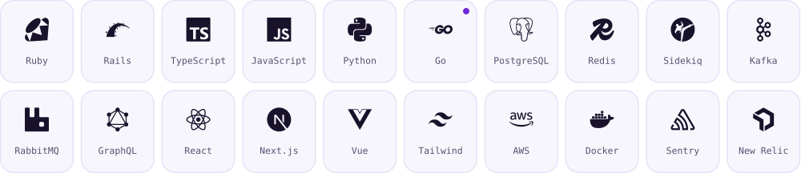

<b>English</b> &nbsp;·&nbsp; <a href="./README.pt-BR.md">Português</a>

<picture>
  <source media="(prefers-color-scheme: dark)" srcset="./assets/en/header-dark.svg">
  
</picture>

Hi! I'm a backend-focused developer with a degree in Information Systems from Estácio and, before that, a technical diploma in IT from EETEPA. Here you'll find some of the things I build outside of work. Most of them started from a question, a pain point, or something I wanted to use myself. Every now and then I also stream on [Twitch](https://www.twitch.tv/wesleysenadev/).

  <a href="https://wesleynogueira.com/"><picture>
    <source media="(prefers-color-scheme: dark)" srcset="./assets/en/contacts/contact-website-dark.svg">
    
  </picture></a>
  <a href="https://www.linkedin.com/in/wesley-sena-nogueira/"><picture>
    <source media="(prefers-color-scheme: dark)" srcset="./assets/en/contacts/contact-linkedin-dark.svg">
    
  </picture></a>
  <a href="mailto:wesleysena.dev@gmail.com"><picture>
    <source media="(prefers-color-scheme: dark)" srcset="./assets/en/contacts/contact-email-dark.svg">
    
  </picture></a>
  <a href="https://www.instagram.com/wesleysena.dev/"><picture>
    <source media="(prefers-color-scheme: dark)" srcset="./assets/en/contacts/contact-instagram-dark.svg">
    
  </picture></a>

 

## Projects

  <a href="https://github.com/LordWeli/EpicTracker"><picture>
    <source media="(prefers-color-scheme: dark)" srcset="./assets/en/project-epictracker-dark.svg">
    
  </picture></a>

  <a href="https://github.com/LordWeli/TaskDone"><picture>
    <source media="(prefers-color-scheme: dark)" srcset="./assets/en/project-taskdone-dark.svg">
    
  </picture></a>
  <a href="https://wesleynogueira.com"><picture>
    <source media="(prefers-color-scheme: dark)" srcset="./assets/en/project-site-dark.svg">
    
  </picture></a>
  <a href="https://github.com/LordWeli/work_vision"><picture>
    <source media="(prefers-color-scheme: dark)" srcset="./assets/en/project-workvision-dark.svg">
    
  </picture></a>

- In 2020 I built [COVID19-PA](https://github.com/LordWeli/COVID19-PA), a map of COVID-19 cases in the state of Pará, using open data from Brasil.IO.
- I'm always venturing into some new technology. Right now I'm learning **Golang** by building with **LLMs** and **RAG**.

 

## Technologies I work with

<picture>
  <source media="(prefers-color-scheme: dark)" srcset="./assets/en/stack-dark.svg">
  
</picture>
