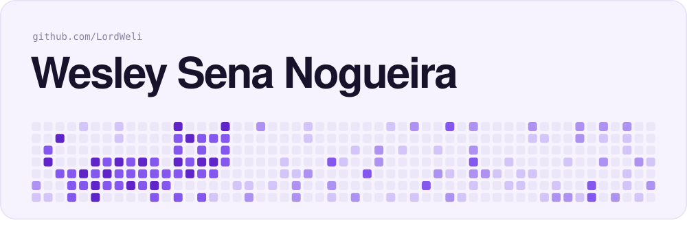
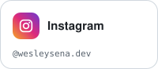
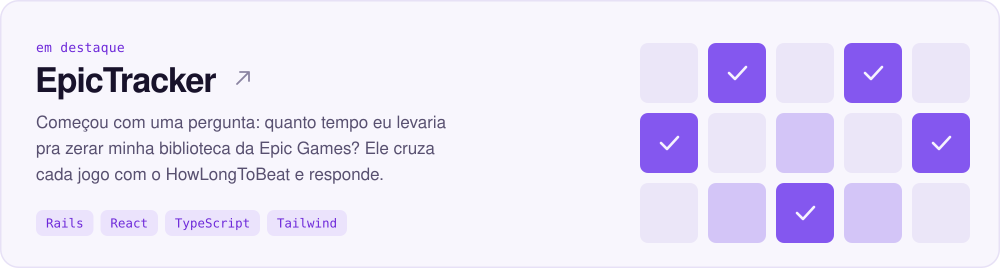
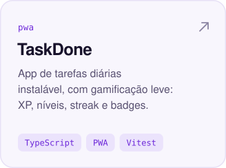
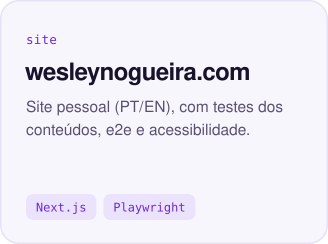
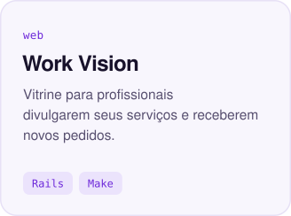
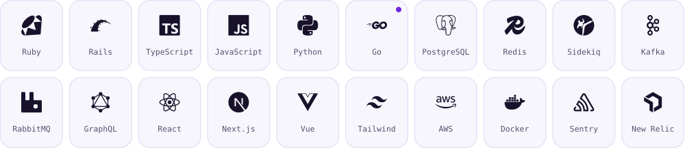

<a href="./README.md">English</a> &nbsp;·&nbsp; <b>Português</b>

<picture>
  <source media="(prefers-color-scheme: dark)" srcset="./assets/br/header-dark.svg">
  
</picture>

Olá! Sou desenvolvedor com foco em backend, formado em Sistemas de Informação pela Estácio e também técnico em informática pela EETEPA. Aqui você vai encontrar algumas coisas que construo fora do trabalho. A maioria nasceu de alguma dúvida, dificuldade e coisas que eu queria utilizar. De vez em quando também estou ao vivo na [Twitch](https://www.twitch.tv/wesleysenadev/).

  <a href="https://wesleynogueira.com/"><picture>
    <source media="(prefers-color-scheme: dark)" srcset="./assets/br/contacts/contact-website-dark.svg">
    
  </picture></a>
  <a href="https://www.linkedin.com/in/wesley-sena-nogueira/"><picture>
    <source media="(prefers-color-scheme: dark)" srcset="./assets/br/contacts/contact-linkedin-dark.svg">
    
  </picture></a>
  <a href="mailto:wesleysena.dev@gmail.com"><picture>
    <source media="(prefers-color-scheme: dark)" srcset="./assets/br/contacts/contact-email-dark.svg">
    
  </picture></a>
  <a href="https://www.instagram.com/wesleysena.dev/"><picture>
    <source media="(prefers-color-scheme: dark)" srcset="./assets/br/contacts/contact-instagram-dark.svg">
    
  </picture></a>

 

## Projetos

  <a href="https://github.com/LordWeli/EpicTracker"><picture>
    <source media="(prefers-color-scheme: dark)" srcset="./assets/br/project-epictracker-dark.svg">
    
  </picture></a>

  <a href="https://github.com/LordWeli/TaskDone"><picture>
    <source media="(prefers-color-scheme: dark)" srcset="./assets/br/project-taskdone-dark.svg">
    
  </picture></a>
  <a href="https://wesleynogueira.com"><picture>
    <source media="(prefers-color-scheme: dark)" srcset="./assets/br/project-site-dark.svg">
    
  </picture></a>
  <a href="https://github.com/LordWeli/work_vision"><picture>
    <source media="(prefers-color-scheme: dark)" srcset="./assets/br/project-workvision-dark.svg">
    
  </picture></a>

- Em 2020  fiz o projeto [COVID19-PA](https://github.com/LordWeli/COVID19-PA), um mapa dos casos de COVID-19 no estado do Pará, utilizando os dados abertos do Brasil.IO. 
- Sempre estou me aventurando aprendendo alguma nova tecnologia. Atualmente estou aprendendo **Golang** com implementação de **LLM** e **RAG**.

 

## Tecnologias com que trabalho

<picture>
  <source media="(prefers-color-scheme: dark)" srcset="./assets/br/stack-dark.svg">
  
</picture>
